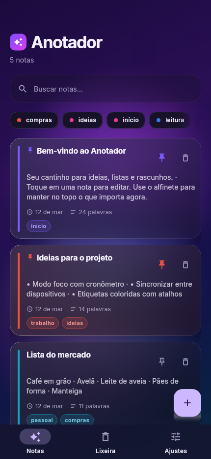

# Anotador

App de notas em Flutter, local-first, com visual expressivo e tema claro/escuro.



## O que ele faz

- Criar, editar e apagar notas
- Fixar notas no topo
- Buscar por título, corpo e etiquetas — **ignorando acentos** (`ação` encontra `acao`)
- Etiquetas coloridas com filtro combinável (todas as etiquetas ativas precisam casar)
- Lixeira com restauração, "Desfazer" e esvaziamento
- Escolha de cor por nota (8 cores) e editor com salvamento automático
- Escolha de tema (Sistema / Claro / Escuro) e modo compacto da lista

Tudo fica **no dispositivo**, em um banco local via `hive_ce`. Sem conta, sem login,
sem sincronização na nuvem — nada do que você escreve sai do aparelho.

## Requisitos e ambiente

O ambiente é reproduzível com [Nix](https://nixos.org). O `flake.nix` traz Flutter,
Dart, Chromium (para conferência visual) e a geração das fontes:

```bash
nix develop -c flutter --version   # Flutter 3.47.4 • Dart 3.13.3
```

## Comandos

Todos os comandos passam pelo dev shell:

```bash
# Rodar os testes (59 no total: unidade, widget e golden)
nix develop -c flutter test

# Análise estática (precisa sair limpo)
nix develop -c flutter analyze

# Build Android
nix develop -c flutter build apk --release

# Build web
nix develop -c flutter build web --release
```

### Popular com notas de exemplo

```bash
nix develop -c flutter run --dart-define=SEED_DEMO=true
```

### Forçar um tema (útil para conferir os dois)

```bash
nix develop -c flutter run --dart-define=SEED_DEMO=true --dart-define=FORCE_THEME=dark
```

## Como conferir o visual sem tela

Este host **não tem desktop environment**, então as capturas são geradas pelo
próprio Flutter (`flutter_tester`), sem navegador e sem GPU:

```bash
nix develop -c flutter test test/golden_capture_test.dart --update-goldens
cp test/goldens/*.png shots/
```

As imagens ficam em [`shots/`](shots), uma por tela e combinação de tema —
incluindo o editor nos dois temas, justamente o par que mais sofre com
contraste. Para regenerar as fontes estáticas da Inter (a partir da fonte
variável do nixpkgs):

```bash
bash scripts/gen-fonts.sh
```

## Arquitetura

```
lib/
  main.dart              bootstrap: abre o Hive, aplica dart-defines, sobe o app
  app.dart               AnotadorApp: publica os controladores e monta o MaterialApp
  core/theme/            paleta expressiva e ThemeData claro/escuro
  core/utils/            formatação de datas em pt-BR
  data/                  Note (modelo) e NoteRepository (Hive)
  state/                 NotesController, SettingsController + SettingsStore, scopes
  ui/screens/            shell, lista, editor, lixeira, ajustes
  ui/widgets/            aurora, cartão de vidro, cartão de nota, busca, etiquetas
```

Decisões que valem explicação:

- **Sem geração de código.** As notas são gravadas como `Map<String, dynamic>`
  dentro de uma box do Hive — nada de `TypeAdapter` ou `build_runner`.
- **`SettingsStore`** isola o Hive atrás de uma interface com duas
  implementações: `HiveSettingsStore` (app) e `InMemorySettingsStore` (testes).
  É o que permite testar sem disco e sem o relógio virtual do `flutter_test`.
- **Estado com `ChangeNotifier` + `InheritedNotifier`**, sem Riverpod nem
  `provider`: para este tamanho de app, é menos uma dependência.
- **Rotas empilhadas têm fundo próprio.** O editor abre acima do shell no overlay
  do `Navigator`, ou seja, *fora* do `AuroraBackground` do shell — sem um fundo
  próprio ele deixaria vazar a cor base e o texto de tema escuro ficaria ilegível.
- **A sombra dos cartões é pintada à mão.** Um `BoxShadow` com `blurRadius` não
  desenha a queda no renderer de golden: ele some ou vira uma laje chapada com
  corte duro. A sombra é um gradiente vertical atrás do cartão, com
  `Clip.none` no `Stack` para que ela realmente ultrapasse a borda.

O contrato entre as camadas está em [`ARCHITECTURE.md`](ARCHITECTURE.md).

## Testes

```
test/notes_test.dart           modelo, tolerância a JSON legado, ordenação e filtros
test/widget_test.dart          navegação, busca, lixeira, tema, editor, falhas de escrita
test/golden_capture_test.dart  renderiza as telas em PNG para revisão visual
test/support/fakes.dart        repositórios e notas de teste compartilhados
test/flutter_test_config.dart  carrega as fontes reais fora do relógio virtual
```

`flutter_test_config.dart` existe porque `testWidgets` roda num relógio virtual:
carregar fontes ou tocar em disco **dentro** de um teste trava. O arquivo roda em
`testExecutable`, fora desse relógio.